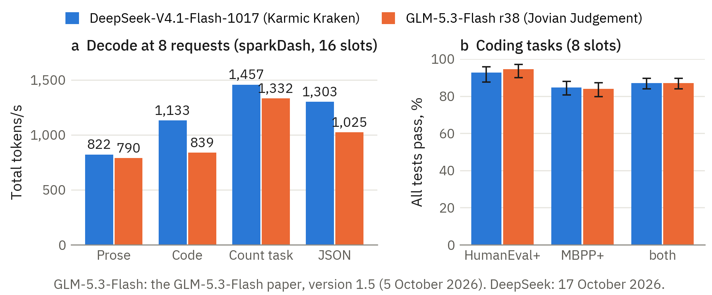
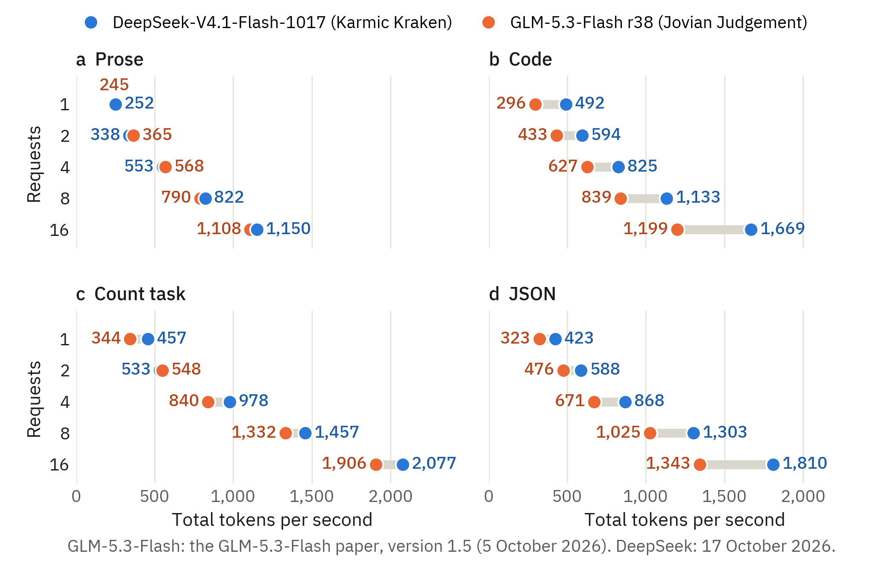
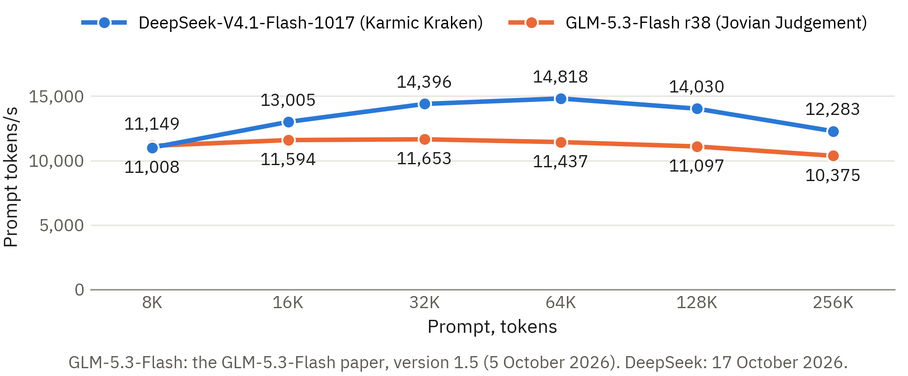
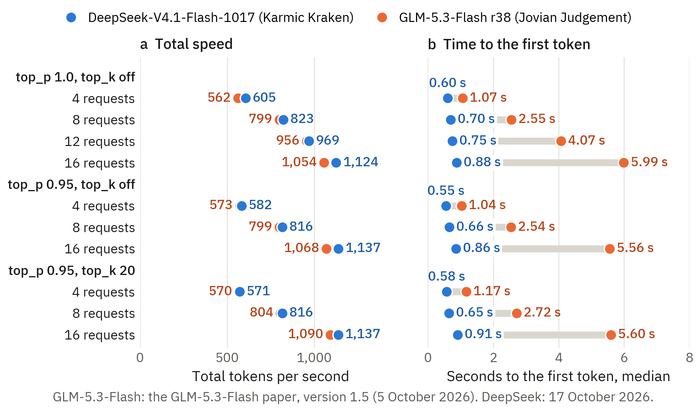
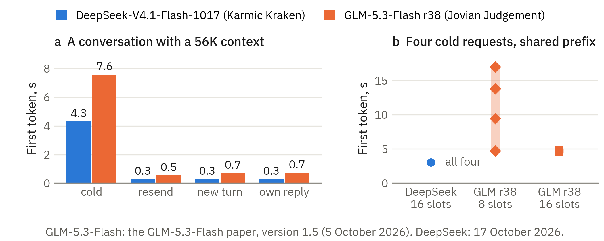

# DeepSeek-V4.1-Flash-1017 on four RTX PRO 6000 Blackwell GPUs: tests against GLM-5.3-Flash

Authors: [commdata2338](https://github.com/commdata2338) and [Claude Opus 5.5](https://www.anthropic.com/claude), an AI model of Anthropic. Version 1.1, 18 October 2026.

Each result is from one run on one host, unless the text gives a different number of runs. Tell us if you find an
error.

This paper uses the tests of the paper
[GLM-5.3-Flash on four RTX PRO 6000 Blackwell GPUs](https://github.com/commdata2338/glm-5.3-flash-4x-rtx-pro-6000-benchmark)
(the GLM paper). It gives the results of DeepSeek-V4.1-Flash-1017 on Karmic Kraken, the vLLM fork of Local Inference
Lab, beside the best configuration of that paper. We did not measure GLM-5.3-Flash again. Its values are from
version 1.5 of the GLM paper. Appendix F gives the results of the same weights on SGLang.

**Note: two different branches of the engine.** The two inference stacks did not use the same engine release.
GLM-5.3-Flash used release r38 of Jovian Judgement, and DeepSeek-V4.1-Flash-1017 used the Karmic Kraken beta of 16
October 2026. These are two different release lines of the vLLM fork of Local Inference Lab, with the development
branches [`dev/jovian-judgement`](https://github.com/local-inference-lab/vllm/tree/dev/jovian-judgement) and
[`dev/karmic-kraken`](https://github.com/local-inference-lab/vllm/tree/dev/karmic-kraken). Thus a part of each
difference in this paper can come from the engine and not from the model. We will do the tests of GLM-5.3-Flash again
on Karmic Kraken, and we will add the results to this paper.

**Update of 18 October 2026 (version 1.1).** This version adds a check of the Engram tables in the host memory of
Karmic Kraken, after a question from a reader. No other result changed.

- Appendix A has the check and a new table. All of the tables stayed in page-locked host memory, and the drive with
  the weights read at most 0.179 MB/s in 5 s.
- Section 6 and Appendix F refer to the check.
- The new values are in `data/engram_ram_kk.csv`. They come from
  `raw/deepseek-v4.1-flash-1017/engram-residency-check.json` and from the samples of two qualification runs.

## Credits

Other people made the models and the software that this paper tests.

- [DeepSeek-V4.1-Flash-1017](https://huggingface.co/deepseek-ai/DeepSeek-V4.1-Flash-1017): [DeepSeek](https://www.deepseek.com).
- [Karmic Kraken](https://github.com/local-inference-lab/vllm) (the vLLM fork of Local Inference Lab), its launcher
  and its [images](https://github.com/local-inference-lab/blackwell-llm-docker), the B12X kernels, and
  [Jovian Judgement](https://github.com/local-inference-lab/vllm), the release line before it:
  [local-inference-lab](https://github.com/local-inference-lab) and its contributors.
- [vLLM](https://github.com/vllm-project/vllm): the vLLM project.
- [GLM-5.3-Flash](https://huggingface.co/zai-org/GLM-5.3-Flash): [Z.ai](https://z.ai). The
  [NVFP4 checkpoint of GLM-5.3-Flash](https://huggingface.co/local-inference-lab/GLM-5.3-Flash-NVFP4): local-inference-lab.
- [SGLang](https://github.com/sgl-project/sglang): the SGLang project. The
  [recipe for DeepSeek-V4.1-Flash on four RTX PRO 6000 GPUs](https://github.com/sybil-solutions/deepseek-v4.1-flash-4x-rtx-pro-6000):
  sybil-solutions (first published by [0xSero](https://github.com/0xSero)). Appendix F uses them.
- [FlashInfer](https://github.com/flashinfer-ai/flashinfer): the FlashInfer project.
- [sparkDash](https://github.com/MiaAI-Lab/sparkDash): [Mia's AI Lab](https://huggingface.co/Mia-AiLab).
- [pi](https://github.com/earendil-works/pi), the agent of the quality harness: the pi project.
- [EvalPlus](https://github.com/evalplus/evalplus), HumanEval+, and MBPP+: the EvalPlus team.
  [HumanEval](https://github.com/openai/human-eval) is from OpenAI, and
  [MBPP](https://github.com/google-research/google-research/tree/master/mbpp) is from Google Research.

## Summary

**On Karmic Kraken, DeepSeek-V4.1-Flash-1017 was faster than GLM-5.3-Flash, or within 10% of it, in each speed
test. The two inference stacks passed the same number of Python tasks.**

DeepSeek-V4.1-Flash-1017 is a language model of DeepSeek. Its release date is 17 October 2026. We served it on one
workstation with four RTX PRO 6000 Blackwell GPUs. Then we did the tests of the GLM paper on it. This paper compares
two inference stacks on that workstation. An inference stack is a model with the software that serves it. Only one
inference stack operated at a time.

**What we tested.** The inference stack of DeepSeek-V4.1-Flash-1017 has four parts.

- **The engine** is Karmic Kraken, the vLLM fork of Local Inference Lab, in its beta image of 16 October 2026 and
  with its profile for DeepSeek-V4.1-Flash. We changed four settings of the profile (section 1).
- **The weights** are the weights that DeepSeek published, with no other compression: FP8 for the dense layers and
  FP4 for the experts.
- **The draft method** is DSpark, the draft layers of the model, with 7 draft tokens and adaptive verification.
- **The Engram tables** are 189.1 GiB of lookup tables that the model uses at two layers. They do not fit on the
  GPUs. The server keeps them in the memory of the host, and the GPUs read them there.

The comparison is the best configuration of the GLM paper: GLM-5.3-Flash on release r38 of Jovian Judgement, the
earlier release line of the same fork, with the checkpoint policy `aligned`.

| Inference stack | Engine | Weights | Draft method | Requests at the same time |
|---|---|---|---|---|
| **DeepSeek-V4.1-Flash-1017** | Karmic Kraken beta of 16 October 2026 (vLLM fork) | DeepSeek FP8 and FP4, revision `1bae0e10` | DSpark, 7 tokens, adaptive | 16 in the speed tests; 8 in the quality run and in a second round of the speed tests |
| **GLM-5.3-Flash r38** | Jovian Judgement r38 (vLLM fork) | NVFP4 | The MTP head of the model | 16 in the speed tests, 8 in the quality run |

*Figure 1. Panel a is the decode test of sparkDash with 8 requests, 16 slots on each inference stack. Panel b is the
share of 542 Python tasks that passed all tests, with the 95% interval, 8 slots on each inference stack. Sections 2
and 7 give the conditions.*

**Which inference stack had the better result for each load in our tests**

| Load | Better result | Section |
|---|---|---|
| Short greedy answers, 1 request | DeepSeek-V4.1-Flash-1017. For prose, the difference is less than 5%. | 2 |
| Short greedy answers, 8 and 16 requests | DeepSeek-V4.1-Flash-1017. For prose and for the count task, the difference is less than 10%. | 2 |
| A long prompt that the server reads for the first time | Equal at 8K tokens. DeepSeek-V4.1-Flash-1017 from 16K tokens, in tokens per second. Section 3 gives a limit of this comparison. | 3 |
| A long shared context, 4 to 16 requests, thinking on | Equal within 10% in speed. DeepSeek-V4.1-Flash-1017 gave the first token sooner. | 4 |
| A shared context with a different question in each request | No clear difference: each inference stack reused the context | 5 |
| Four cold requests that arrive together with a shared prefix | DeepSeek-V4.1-Flash-1017 | 5 |
| Accuracy of Python tasks through an agent | No difference found | 7 |
| A passphrase in a prompt of up to 200K tokens | Both inference stacks recalled it. DeepSeek-V4.1-Flash-1017 was faster. | 8 |

This table is for one host and for these tests. It is not a general recommendation. Section 10 gives the limits.

The other primary results are these:

- **Tokens are not the same unit.** For the same text, the tokenizer of GLM-5.3-Flash made 37% more tokens than the
  tokenizer of DeepSeek in the conversation test. For a synthetic prompt, it made 3% more. Thus a speed in tokens
  per second is not a speed in text (section 3).
- **The KV cache holds long contexts.** With 16 slots, the KV cache of DeepSeek-V4.1-Flash-1017 had space for
  8,050,969 tokens. That is 7.68 requests with the full context of 1,048,576 tokens (section 6).
- **The engine is important.** On the same host, the same weights on SGLang were 1.34 to 2.58 times slower in the
  decode and prefill tests (Appendix F).
- **Two rounds gave the same speed.** With 8 slots, the second round of the speed suite was within 4% of the first
  round in each test (section 9).

## Contents

The body gives the results. The appendixes give the inference stack, the method, the full tables, and more tests.

- [1. The two inference stacks](#1-the-two-inference-stacks)
- [2. Short greedy answers](#2-short-greedy-answers)
- [3. Prefill of a cold prompt](#3-prefill-of-a-cold-prompt)
- [4. Long shared context and sampler settings](#4-long-shared-context-and-sampler-settings)
- [5. Time to the first token, and reuse of a prompt](#5-time-to-the-first-token-and-reuse-of-a-prompt)
- [6. The KV cache and the draft method](#6-the-kv-cache-and-the-draft-method)
- [7. Quality through an agent](#7-quality-through-an-agent)
- [8. Correctness](#8-correctness)
- [9. Two rounds of the speed suite](#9-two-rounds-of-the-speed-suite)
- [10. Limits](#10-limits)
- [Appendix A. The inference stack and the host](#appendix-a-the-inference-stack-and-the-host)
- [Appendix B. Method](#appendix-b-method)
- [Appendix C. Full speed results](#appendix-c-full-speed-results)
- [Appendix D. More tests](#appendix-d-more-tests)
- [Appendix E. How to do the tests again](#appendix-e-how-to-do-the-tests-again)
- [Appendix F. The same weights on SGLang](#appendix-f-the-same-weights-on-sglang)
- [License](#license)
- [About the text](#about-the-text)

## 1. The two inference stacks

**The two inference stacks have different models, weights, and tokenizers. Their engines are two release lines of
the same vLLM fork. This paper compares two complete inference stacks, not two models.**

DeepSeek-V4.1-Flash-1017 has new weights for each of the 48 files of DeepSeek-V4.1-Flash (September 2026). The
architecture, the configuration, and the tokenizer did not change. The model has 40 layers and 384 routed experts.
It uses 6 experts for each token. Its attention is sparse and compressed. Its Engram tables are lookup tables for
n-grams at layers 1 and 14.

The engine is the image `karmic-kraken-beta-20261016.2` of Local Inference Lab, with its profile `ds41-flash`. The
profile uses the B12X kernels of the fork for attention, the experts, and the dense layers. We changed four settings
of the profile:

1. **The weights:** `--checkpoint original`, the files of DeepSeek. The profile uses a container of Local Inference Lab by
   default.
2. **The slots:** 16 for the speed tests and 8 for the quality run and the second round. The default is 32.
3. **The GPU memory:** a share of 0.93. The default is 0.95. A small process of the host uses one GPU.
4. **The sampler defaults:** temperature 1.0 and top_p 1.0, as the model card of the 1017 release recommends. The
   default of the profile is top_p 0.95.

The Engram tables are in host memory (`--engram-table-memory ram`), and no external cache is on
(`--cache-mode vram`). [`recipes/deepseek-v4.1-flash-1017.md`](recipes/deepseek-v4.1-flash-1017.md) gives each
setting, and `raw/` contains the full start command that the launcher made.

**The first start of a configuration tunes the kernels.** The B12X kernels have more than one form for each shape of
a matrix. At the first start, the server measures the forms for each shape that it will use and keeps the fastest.
The server saves the result on disk, and a later start uses it. Appendix A gives the times and the memory.

**The test tools of the GLM paper did not change.** They send the model name `glm-5.3-flash`, the thinking switch of
GLM, and no API key. A small adapter ([`tools/glm_api_adapter.py`](tools/glm_api_adapter.py)) sends each request to
the DeepSeek server. It adds the API key and changes the model name. It also changes `enable_thinking` to
`thinking`. Appendix B gives each change.

**Known differences.** The release notes of Karmic Kraken do not name the 1017 release, and Local Inference Lab had not tested
it when we did our tests. The reference code of the 1017 release rounds the input of the projection `wo_a` to FP8
and back, and it has a fix of the indexer cache. We did not examine whether Karmic Kraken has these two changes.

## 2. Short greedy answers

**At 1, 8, and 16 requests, DeepSeek-V4.1-Flash-1017 had a higher total speed for each output type. For prose, the
difference was less than 5%. For code, DeepSeek-V4.1-Flash-1017 was 1.35 to 1.66 times faster. At 2 and 4 requests,
GLM-5.3-Flash was up to 8% faster for prose and 3% faster for the count task (Appendix C).**

The decode test of sparkDash sends prompts with thinking off and asks for 400 tokens with greedy sampling. There are
four output types: prose (explain a hash map), code (a different small Python task for each stream), the count task
(count from 1 to 200), and JSON (write an array of GPU metrics). The first DeepSeek column is the configuration with 16
slots. The second DeepSeek column is the mean of two rounds with 8 slots. At 16 requests, 8 of its requests wait.

*Figure 2. Total tokens per second for each number of requests, one panel for each output type, 16 slots on each
inference stack. Further right is faster. The four panels have the same axis.*

<!-- table: decode_body -->
| Output type | Requests | DeepSeek 16 slots, tok/s | DeepSeek 8 slots, tok/s | GLM r38, tok/s | DeepSeek 16 slots / GLM |
|---|---:|---:|---:|---:|---:|
| prose | 1 | 252 | 247 | 245 | 1.03 |
| prose | 8 | 822 | 814 | 790 | 1.04 |
| prose | 16 | 1,150 | 785 | 1,108 | 1.04 |
| code | 1 | 492 | 494 | 296 | 1.66 |
| code | 8 | 1,133 | 1,188 | 839 | 1.35 |
| code | 16 | 1,669 | 1,108 | 1,199 | 1.39 |
| count task | 1 | 457 | 449 | 344 | 1.33 |
| count task | 8 | 1,457 | 1,442 | 1,332 | 1.09 |
| count task | 16 | 2,077 | 1,362 | 1,906 | 1.09 |
| json | 1 | 423 | 416 | 323 | 1.31 |
| json | 8 | 1,303 | 1,277 | 1,025 | 1.27 |
| json | 16 | 1,810 | 1,240 | 1,343 | 1.35 |

- The draft layers of DeepSeek accept more tokens for code and JSON than for prose (section 6).
- Appendix C has the full table with the speed of each stream and the time to the first token.

The greedy test with a context of 1K tokens gave the same result:

<!-- table: greedy_body -->
| Sampler | Requests | DeepSeek, 16 slots: total tok/s | first token s | DeepSeek, 8 slots: total tok/s | first token s | GLM r38, 16 slots: total tok/s | first token s |
|---|---:|---:|---:|---:|---:|---:|---:|
| top_p 1.0, top_k off | 1 | 259 | 0.22 | 251 | 0.25 | 236 | 0.18 |
| top_p 1.0, top_k off | 8 | 873 | 0.47 | 866 | 0.47 | 776 | 0.97 |
| top_p 1.0, top_k off | 12 | 1,045 | 0.56 | no test | no test | 968 | 0.78 |
| top_p 1.0, top_k off | 16 | 1,213 | 0.63 | no test | no test | 1,046 | 1.56 |

## 3. Prefill of a cold prompt

**The two inference stacks read a cold prompt of 8K tokens at the same speed. From 16K tokens,
DeepSeek-V4.1-Flash-1017 was 12% to 30% faster in tokens per second.**

*Figure 3. The prefill speed of one cold prompt of 8K to 256K tokens, 16 slots on each inference stack.*

<!-- table: prefill_body -->
| Prompt, tokens | DeepSeek 16 slots, tok/s | first token s | DeepSeek 8 slots, tok/s | first token s | GLM r38, tok/s | first token s |
|---|---:|---:|---:|---:|---:|---:|
| 8,192 | 11,008 | 0.75 | 11,241 | 0.73 | 11,149 | 0.74 |
| 16,384 | 13,005 | 1.26 | 13,084 | 1.25 | 11,594 | 1.42 |
| 32,768 | 14,396 | 2.28 | 14,155 | 2.32 | 11,653 | 2.81 |
| 65,536 | 14,818 | 4.42 | 14,580 | 4.50 | 11,437 | 5.73 |
| 131,072 | 14,030 | 9.34 | 13,841 | 9.47 | 11,097 | 11.81 |
| 262,144 | 12,283 | 21.34 | 11,987 | 21.87 | 10,375 | 25.27 |

- **The two tokenizers are different.** In the conversation test of section 5, the same text was 61,149 tokens for
  DeepSeek and 83,571 tokens for GLM-5.3-Flash. For that text, a prefill speed of 14,000 DeepSeek tokens per second
  is equal to approximately 19,100 GLM tokens per second. For the synthetic prompt of the cold requests, the
  difference was only 3%. We did not measure the speed for the same text with a fixed number of characters.
- The server had only this request. Thus the first-token times include no queue.

## 4. Long shared context and sampler settings

**With a shared context of 56K tokens and thinking on, the two inference stacks had the same total speed within 10%.
The first token of DeepSeek-V4.1-Flash-1017 came after 0.55 to 0.91 s. The first token of GLM-5.3-Flash came after
1.04 to 5.99 s.**

Each request has the same context of 56K tokens and its own question. Thinking is on with effort `max`. Each request
asks for 2,000 tokens with temperature 1. Where an inference stack has two passes of one setting, the table gives
their mean.

*Figure 4. The long-context test for three sampler settings, 16 slots on each inference stack. Panel a is the total
tokens per second, and panel b is the median time to the first token. Where a setting ran two times, the figure gives
the mean.*

<!-- table: longctx_body -->
| Sampler | Requests | DeepSeek, 16 slots: total tok/s | first token s | DeepSeek, 8 slots: total tok/s | first token s | GLM r38, 16 slots: total tok/s | first token s |
|---|---:|---:|---:|---:|---:|---:|---:|
| top_p 1.0, top_k off | 4 | 605 | 0.60 | 560 | 0.57 | 562 | 1.07 |
| top_p 1.0, top_k off | 8 | 823 | 0.70 | 820 | 0.66 | 799 | 2.55 |
| top_p 1.0, top_k off | 12 | 969 | 0.75 | no test | no test | 956 | 4.07 |
| top_p 1.0, top_k off | 16 | 1,124 | 0.88 | no test | no test | 1,054 | 5.99 |
| top_p 0.95, top_k off | 4 | 582 | 0.55 | 574 | 0.58 | 573 | 1.04 |
| top_p 0.95, top_k off | 8 | 816 | 0.66 | 817 | 0.69 | 799 | 2.54 |
| top_p 0.95, top_k off | 16 | 1,137 | 0.86 | no test | no test | 1,068 | 5.56 |
| top_p 0.95, top_k 20 | 4 | 571 | 0.58 | 568 | 0.55 | 570 | 1.17 |
| top_p 0.95, top_k 20 | 8 | 816 | 0.65 | 816 | 0.70 | 804 | 2.72 |
| top_p 0.95, top_k 20 | 16 | 1,137 | 0.91 | no test | no test | 1,090 | 5.60 |

- The sampler setting did not change the speed of DeepSeek by more than 6%.
- The first-token time of DeepSeek stayed below 1 s at 16 requests.

**Why the first token came sooner on DeepSeek.** Before each group of requests, the probe sends one request with the
same context. Thus the context is in the cache of the server when the group starts.

- On Karmic Kraken, one request of each group got its first token after approximately 0.3 s. All other requests got
  it together after 0.55 to 0.94 s. For each request, the server reported 55,808 prompt tokens from its cache and 145
  or 146 new tokens.
- On Jovian Judgement r38, the requests started two at a time, approximately 1.5 s apart. With 16 requests, the last
  request got its first token after 11.2 to 11.9 s.
- A possible cause is the design of GLM-5.3-Flash. Most of its layers are linear attention, and r38 can use their
  saved state only at limits of 2,048 tokens.
- The engine is also a possible cause. On TensorFold, the median first token of the same model at 16 requests came
  after 2.3 s, against 5.6 s on r38 (section 4 of the GLM paper, top_p 0.95 and no top_k). The test of
  GLM-5.3-Flash on Karmic Kraken will show which cause is larger.
- The Engram tables are not a cause. They add a table lookup for each token at two layers, and the tokens from the
  cache do not need them again.
- The data: the files `longctx-*-raw.jsonl` in `raw/deepseek-v4.1-flash-1017/16-slots/` and in
  `raw/glm-5.3-flash-r38/16-slots-policy-aligned/`.

The same test with the context in a system message gave similar values:

<!-- table: system_body -->
| Sampler | Requests | DeepSeek, 16 slots: total tok/s | first token s | DeepSeek, 8 slots: total tok/s | first token s | GLM r38, 16 slots: total tok/s | first token s | GLM r38, 8 slots: total tok/s | first token s |
|---|---:|---:|---:|---:|---:|---:|---:|---:|---:|
| top_p 0.95, top_k 20 | 4 | 580 | 0.57 | 563 | 0.55 | 559 | 1.05 | 582 | 1.45 |
| top_p 0.95, top_k 20 | 8 | 810 | 0.64 | 823 | 0.68 | 793 | 2.56 | 813 | 1.62 |
| top_p 0.95, top_k 20 | 16 | no test | no test | no test | no test | 1,096 | 5.59 | no test | no test |
| top_p 0.95, top_k off | 4 | 648 | 0.56 | 616 | 0.59 | no test | no test | 570 | 0.81 |
| top_p 0.95, top_k off | 8 | 836 | 0.74 | 810 | 0.68 | no test | no test | 832 | 1.61 |

## 5. Time to the first token, and reuse of a prompt

**Both inference stacks reused a prompt that they had read before. DeepSeek-V4.1-Flash-1017 read the shared prefix of
four cold requests one time, and the four requests started together after 3.0 s.**

*Figure 5. Panel a is the time to the first token of a conversation with a context of 56K tokens: cold, sent again,
and with a new turn. Panel b is the time to the first token of four cold requests that arrive together with a shared
prefix of 41K tokens.*

The conversation test sends a conversation cold, then sends it again, then adds a new turn. The values are the mean
of two rounds, 16 slots on each inference stack:

<!-- table: warm_chat -->
| Nominal size | Request | DeepSeek, prompt tokens | DeepSeek, first token s | GLM r38, prompt tokens | GLM r38, first token s |
|---|---:|---:|---:|---:|---:|
| 9,000 | cold | 9,853 | 0.80 | 13,526 | 1.21 |
| 9,000 | identical resend | 9,853 | 0.25 | 13,526 | 0.41 |
| 9,000 | resend + new turn | 10,517 | 0.24 | 14,424 | 0.58 |
| 9,000 | own reply + new turn | 10,555 | 0.25 | 14,483 | 0.55 |
| 56,000 | cold | 61,149 | 4.31 | 83,571 | 7.57 |
| 56,000 | identical resend | 61,149 | 0.28 | 83,571 | 0.55 |
| 56,000 | resend + new turn | 61,813 | 0.28 | 84,469 | 0.70 |
| 56,000 | own reply + new turn | 61,902 | 0.28 | 84,527 | 0.73 |

The prompt-reuse check sends a shared context of 56K tokens with a question, then the same request again, then a
different question. A step that takes as much time as the first step did the prefill again:

<!-- table: reuse_check -->
| Shared context in | Step | DeepSeek 16 slots, s | DeepSeek 8 slots, s | GLM r38 8 slots, s | GLM r38 16 slots, s |
|---|---:|---:|---:|---:|---:|
| user message | first request, 16 tokens | 4.06 | 3.81 | 5.68 | 5.03 |
| user message | the same request again | 0.34 | 0.32 | 0.42 | 0.58 |
| user message | same context, other question | 0.32 | 0.33 | 4.85 | 0.55 |
| user message | the same request, 300 tokens | 1.39 | 1.47 | 1.14 | 1.54 |
| user message | the same request again, after 300 tokens | 0.31 | 0.31 | 0.20 | 0.44 |
| user message | same context, third question | 0.32 | 0.30 | 4.91 | 0.44 |
| system message | first request, 16 tokens | 3.96 | 3.83 | 5.10 | 4.82 |
| system message | the same request again | 0.31 | 0.30 | 0.43 | 0.44 |
| system message | same context, other question | 0.32 | 0.30 | 0.42 | 0.52 |
| system message | same context, third question | 0.35 | 0.31 | 0.28 | 0.44 |

The test with four cold requests sends four requests at the same time. They have the same prefix of approximately
41K tokens and a different end:

<!-- table: cold_burst -->
| Inference stack | Requests | Prompt tokens | First token, earliest s | First token, latest s | Last reply ends, s |
|---|---:|---:|---:|---:|---:|
| DeepSeek, 16 slots | 4 | 41,041 | 3.02 | 3.02 | 3.90 |
| DeepSeek, 8 slots | 4 | 41,041 | 3.03 | 3.03 | 3.86 |
| GLM r38, 16 slots | 4 | 42,251 | 4.53 | 4.89 | 5.72 |
| GLM r38, 8 slots | 4 | 42,251 | 4.70 | 16.98 | 17.47 |
| DeepSeek on SGLang, 8 slots | 4 | 41,043 | 5.54 | 5.54 | 7.20 |

## 6. The KV cache and the draft method

**With 16 slots, the KV cache had space for 8,050,969 tokens. The draft layers gave 3.23 to 3.95 tokens for each step
on average.**

The engine gives the KV cache the GPU memory that the weights and the CUDA graphs do not use. The KV cache uses FP8.

<!-- table: server_facts -->
| Slots | Batched tokens | GPU memory share | KV cache type | Context, tokens | KV cache, tokens | Full-length requests that fit | Engram tables in host RAM, GiB | Weights per GPU, GiB | Engine start, s |
|---|---:|---:|---:|---:|---:|---:|---:|---:|---:|
| 16 | 4096 | 0.93 | fp8 | 1,048,576 | 8,050,969 | 7.68 | 188.83 | 74.29 | 277 |
| 8 | 4096 | 0.93 | fp8 | 1,048,576 | 8,560,931 | 8.16 | 188.83 | 74.29 | 175 |

- The context of each request can be 1,048,576 tokens, the context of the model.
- The Engram tables use 188.83 GiB of host memory. The GPUs read the rows from that memory. Appendix A shows that
  all of the tables stayed in that memory.

The log of the server gives the draft tokens that the model accepted, every 10 s, over all tests of each
configuration. One step makes the accepted draft tokens and one token of the model:

<!-- table: acceptance -->
| Inference stack | Slots | Log lines | Lines | Mean tokens per step | Lowest | Highest | Draft tokens accepted |
|---|---:|---:|---:|---:|---:|---:|---:|
| DeepSeek-V4.1-Flash-1017, SGLang | 8 slots | decode batch lines | 1742 | 4.21 | 2.38 | 6.0 | no value |
| DeepSeek-V4.1-Flash-1017, Karmic Kraken | 8 slots | speculative-decoding lines (10 s) | 304 | 3.95 | 1.98 | 7.71 | 66.5% |
| DeepSeek-V4.1-Flash-1017, Karmic Kraken | 16 slots | speculative-decoding lines (10 s) | 62 | 3.23 | 2.0 | 6.29 | 62.6% |

- With 16 slots, the mean is lower. We think that the cause is the adaptive verification, which checks fewer draft
  tokens in a larger batch. We did not test this cause.
- The SGLang row is from a different log line and a different draft length (Appendix F). Do not compare it directly.

## 7. Quality through an agent

**Through the pi agent, DeepSeek-V4.1-Flash-1017 and GLM-5.3-Flash passed 472 of 542 Python tasks each. The paired
test found no difference.**

The harness of the GLM paper gives the same Python tasks to each inference stack through the pi agent 0.86.1. The
tasks are HumanEval+ (164) and MBPP+ (378) from EvalPlus 0.3.1. The agent can run Python, read the errors, and write
the file again. Thinking is on with effort `max`, and each model call can make up to 32,768 tokens. Do not compare
these scores with scores from single requests. Each inference stack had 8 slots.

<!-- table: quality_body -->
| Data set | Tasks | DeepSeek, all tests pass | 95% interval | GLM r38, all tests pass | 95% interval | DeepSeek on SGLang, all tests pass | 95% interval |
|---|---:|---:|---:|---:|---:|---:|---:|
| HumanEval+ | 164 | 152 (92.7%) | 87.6 to 95.8 | 155 (94.5%) | 89.9 to 97.1 | 153 (93.3%) | 88.4 to 96.2 |
| MBPP+ | 378 | 320 (84.7%) | 80.7 to 87.9 | 317 (83.9%) | 79.8 to 87.2 | 319 (84.4%) | 80.4 to 87.7 |
| both | 542 | 472 (87.1%) | 84.0 to 89.6 | 472 (87.1%) | 84.0 to 89.6 | 472 (87.1%) | 84.0 to 89.6 |

The paired comparison uses the same 542 tasks. "Only a" is the number of tasks that only the first run of the
row passed:

<!-- table: quality_paired -->
| Runs | Data set | Tests | Both pass | Only a | Only b | Exact McNemar p | b minus a, points | 95% interval |
|---|---:|---:|---:|---:|---:|---:|---:|---:|
| GLM r38, 8 slots (a), DeepSeek, 8 slots (b) | HumanEval+ | base tests | 160 | 3 | 0 | 0.25 | -1.8 | -3.9 to 0.2 |
| GLM r38, 8 slots (a), DeepSeek, 8 slots (b) | HumanEval+ | all tests | 149 | 6 | 3 | 0.5078 | -1.8 | -5.4 to 1.7 |
| GLM r38, 8 slots (a), DeepSeek, 8 slots (b) | MBPP+ | base tests | 361 | 4 | 10 | 0.1796 | 1.6 | -0.3 to 3.5 |
| GLM r38, 8 slots (a), DeepSeek, 8 slots (b) | MBPP+ | all tests | 304 | 13 | 16 | 0.7111 | 0.8 | -2.0 to 3.6 |
| GLM r38, 8 slots (a), DeepSeek, 8 slots (b) | both | base tests | 521 | 7 | 10 | 0.6291 | 0.6 | -0.9 to 2.0 |
| GLM r38, 8 slots (a), DeepSeek, 8 slots (b) | both | all tests | 453 | 19 | 19 | 1.0 | 0.0 | -2.2 to 2.2 |
| DeepSeek on SGLang, 8 slots (a), DeepSeek, 8 slots (b) | HumanEval+ | base tests | 159 | 2 | 1 | 1.0 | -0.6 | -2.7 to 1.5 |
| DeepSeek on SGLang, 8 slots (a), DeepSeek, 8 slots (b) | HumanEval+ | all tests | 149 | 4 | 3 | 1.0 | -0.6 | -3.8 to 2.6 |
| DeepSeek on SGLang, 8 slots (a), DeepSeek, 8 slots (b) | MBPP+ | base tests | 369 | 1 | 2 | 1.0 | 0.3 | -0.6 to 1.2 |
| DeepSeek on SGLang, 8 slots (a), DeepSeek, 8 slots (b) | MBPP+ | all tests | 312 | 7 | 8 | 1.0 | 0.3 | -1.7 to 2.3 |
| DeepSeek on SGLang, 8 slots (a), DeepSeek, 8 slots (b) | both | base tests | 528 | 3 | 3 | 1.0 | 0.0 | -0.9 to 0.9 |
| DeepSeek on SGLang, 8 slots (a), DeepSeek, 8 slots (b) | both | all tests | 461 | 11 | 11 | 1.0 | 0.0 | -1.7 to 1.7 |
| GLM r38, 8 slots (a), DeepSeek on SGLang, 8 slots (b) | HumanEval+ | base tests | 161 | 2 | 0 | 0.5 | -1.2 | -2.9 to 0.5 |
| GLM r38, 8 slots (a), DeepSeek on SGLang, 8 slots (b) | HumanEval+ | all tests | 150 | 5 | 3 | 0.7266 | -1.2 | -4.6 to 2.2 |
| GLM r38, 8 slots (a), DeepSeek on SGLang, 8 slots (b) | MBPP+ | base tests | 360 | 5 | 10 | 0.3018 | 1.3 | -0.7 to 3.3 |
| GLM r38, 8 slots (a), DeepSeek on SGLang, 8 slots (b) | MBPP+ | all tests | 303 | 14 | 16 | 0.8555 | 0.5 | -2.3 to 3.4 |
| GLM r38, 8 slots (a), DeepSeek on SGLang, 8 slots (b) | both | base tests | 521 | 7 | 10 | 0.6291 | 0.6 | -0.9 to 2.0 |
| GLM r38, 8 slots (a), DeepSeek on SGLang, 8 slots (b) | both | all tests | 453 | 19 | 19 | 1.0 | 0.0 | -2.2 to 2.2 |

- 19 tasks passed only on GLM-5.3-Flash, and 19 tasks passed only on DeepSeek-V4.1-Flash-1017.
- On SGLang, the same weights also passed 472 tasks. 11 tasks passed only on Karmic Kraken, and 11 tasks passed only
  on SGLang.
- On Karmic Kraken, two tasks of DeepSeek failed because one model call reached the limit of 32,768 tokens, and
  one task reached the time limit of 20 minutes. Appendix D gives the model calls.

## 8. Correctness

**Both inference stacks recalled a passphrase from a prompt of 2,000, 30,000, and 200,000 tokens. Strict JSON schemas
in a batch with other requests did not stop the server.**

The probe puts a passphrase in a long prompt and asks for it. It is the same probe as in the GLM paper.

<!-- table: integrity -->
| Prompt, tokens | DeepSeek 16 slots, recalled | s | DeepSeek 8 slots, recalled | s | GLM r38, recalled | s |
|---|---:|---:|---:|---:|---:|---:|
| 2,000 | yes | 0.28 | yes | 0.29 | yes | 0.33 |
| 30,000 | yes | 1.53 | yes | 1.56 | yes | 2.75 |
| 200,000 | yes | 11.01 | yes | 10.41 | yes | 19.32 |

An open issue of SGLang ([#41449](https://github.com/sgl-project/sglang/issues/41449)) reports that a request with a
strict JSON schema in a batch with other requests can stop the server when DSpark runs on more than one GPU. We did
this test on Karmic Kraken with 8 slots: six rounds, each with two long streamed chats, three requests with a strict
JSON schema, and one request with `tool_choice` set to `required`, all at the same time. Half of the rounds had
thinking on:

<!-- table: batch_schema -->
| Request | Sent | Correct and complete | Slowest, s |
|---|---:|---:|---:|
| long chat, streamed | 12 | 12 | 12.0 |
| strict JSON schema | 18 | 18 | 2.1 |
| tool_choice required | 6 | 6 | 0.9 |

- Each JSON answer matched its schema, and each forced tool call had the correct tool and arguments.
- We did not do this test on SGLang.

## 9. Two rounds of the speed suite

**With 8 slots, we did the speed suite two times. The second round was within 4% of the first round in each test.**

<!-- table: variation -->
| Test | Requests | Round 1, tok/s | Round 2, tok/s | Difference |
|---|---:|---:|---:|---:|
| decode, prose | 1 | 250 | 244 | -2.4% |
| decode, prose | 8 | 827 | 801 | -3.1% |
| decode, code | 1 | 499 | 488 | -2.2% |
| decode, code | 8 | 1,196 | 1,179 | -1.4% |
| decode, count task | 1 | 458 | 440 | -3.9% |
| decode, count task | 8 | 1,462 | 1,421 | -2.8% |
| decode, json | 1 | 421 | 412 | -2.2% |
| decode, json | 8 | 1,294 | 1,261 | -2.6% |
| short greedy answers | 1 | 249 | 252 | +1.0% |
| short greedy answers | 8 | 871 | 862 | -1.1% |
| long context, top_p 1.0 | 4 | 554 | 567 | +2.4% |
| long context, top_p 1.0 | 8 | 806 | 834 | +3.6% |
| long context, top_p 0.95 | 4 | 570 | 588 | +3.1% |
| long context, top_p 0.95 | 8 | 814 | 804 | -1.3% |

The GLM paper found a similar variation between runs (its Appendix B.6).

## 10. Limits

- **One run of most tests.** Only the speed suite with 8 slots had two rounds. A difference of less than 10%
  between the two inference stacks is inside the variation between runs that the GLM paper measured.
- **Different dates and host states.** The GLM-5.3-Flash values are from 5 October 2026 with NVIDIA driver 595.84
  and 128 GB of RAM. The DeepSeek values are from 17 October 2026 with driver 615.71.09 and 377 GiB of RAM.
- **Two branches of the engine.** GLM-5.3-Flash used Jovian Judgement r38, and DeepSeek-V4.1-Flash-1017 used Karmic
  Kraken. A part of each difference can come from the engine. We will do the tests of GLM-5.3-Flash again on Karmic
  Kraken (the note at the start of this paper).
- **Different tokenizers.** Tokens per second are not a speed in text (section 3).
- **A beta engine.** We tested a beta image of Karmic Kraken. Local Inference Lab had not tested the 1017 release.
- **No judgement test.** We did not do a test of written answers. The quality run has only Python tasks.
- **No soak on this engine.** The soak of 60 minutes in Appendix F was on SGLang. The tests in this paper ran on
  Karmic Kraken for 1 hour 25 minutes with no fault, but they are not a soak.

Appendix E gives how to do the tests again.

## Appendix A. The inference stack and the host

[`recipes/deepseek-v4.1-flash-1017.md`](recipes/deepseek-v4.1-flash-1017.md) gives the image, the weights, and each
setting of the server. The server had these settings:

- 4 GPUs with tensor parallel 4.
- 16 or 8 slots, a context of 1,048,576 tokens for each request, 4,096 batched tokens, and a KV cache in FP8.
- DSpark with 7 draft tokens and adaptive verification.
- The Engram tables in host memory, and a container memory limit of 265 GiB.

**The tuning of the kernels.** At the first start of a configuration, the B12X kernels measure their forms for each
shape (section 1). For the configuration with 8 slots, the log gives 1,590 shapes, 98,743 measured forms, and 1,068
compiled kernels in 5 minutes 14 seconds (`raw/deepseek-v4.1-flash-1017/server-log-facts-tuning.json`). During the
tuning, the anonymous memory of the host increased from 53 GiB to 97 GiB, and it decreased when the tuning ended
(`window-monitor.csv` in the same directory). A later start with the same configuration used the saved results: the
engine start took 175 s. The configuration with 16 slots tuned only its new shapes: the engine start took 277 s. A
stop of the server before the first save of a tuning step loses the measurements of that step, but not the compiled
kernels. Our first start stopped in this way, because the memory limit of its container was too low.

**The Engram tables stayed in host memory.** In RAM mode, each GPU rank keeps its share of the tables in page-locked
host memory (`cudaHostAlloc`, in the class `MappedHostAllocation` of B12X in the image). Its GPU reads that memory
directly. At the start, the server copies the rows from the files of the weights into this memory one time. It does
not keep the files mapped, and the Linux kernel cannot page out page-locked memory. Before the server loads the
model, it compares the size of the tables and a reserve of 4 GiB with the available memory. The server uses the
smaller of two values: the available memory of the host, and the container limit minus the memory of the container.
The log gave 263.56 GiB available at the start with 8 slots and 263.73 GiB with 16 slots, for 188.83 GiB of tables.
If the tables do not fit, the server does not start. It does not use the disk in their place. We did these checks
with 8 slots:

<!-- table: engram_kk -->
| Start | Point of the test | Seconds | Read from the drive of the weights, MB | Mean, MB/s | Highest in 5 s, MB/s | Resident shared memory of each worker (RssShmem), GiB | Locked on the host (Mlocked), GiB |
|---|---:|---:|---:|---:|---:|---:|---:|
| 20:00:14 | qualification, integrity (Appendix D) | 15 | 0.1 | 0.009 | 0.022 | no test | 1.8 |
| 20:02:24 | qualification, speed (Appendix D) | 295 | 8.4 | 0.029 | 0.179 | no test | 1.8 |
| 20:15:24 | long-context test, top_p 0.95 and top_k 20, 8 slots | 10 | no value | 0.01 | no value | 47.49 | 1.8 |

- In the check of 10 s during the long-context test, each of the four workers had 47.49 GiB of resident shared
  memory. The share of the tables for each worker is 47.21 GiB.
- The drive with the weights (`nvme1n1` in the raw files) read 0.01 MB/s during that check. In the 295 s of the speed
  qualification, it read 8.4 MB. On SGLang, the four processes read approximately 50 to 60 MB/s during decode
  (Appendix F).
- The locked memory of the host (Mlocked) was 1.8 GiB in these checks. The CUDA driver locks the pages of the
  tables, but this value does not include them. Thus the column "Locked on the host" of Appendix F does not apply to
  Karmic Kraken.
- We did the check of the resident memory one time. The server with 16 slots used the same code, but we did not do
  these checks on it. `raw/deepseek-v4.1-flash-1017/engram-residency-check.json` keeps the command and the output of
  the check, from the record of the test session.

The host is the host of the GLM paper:

- Four NVIDIA RTX PRO 6000 Blackwell Max-Q GPUs with 96 GB each, at a power limit of 250 W, on PCIe.
- An AMD Threadripper PRO 7975WX CPU and 377 GiB of RAM.
- NVIDIA driver 615.71.09, Linux kernel 7.0.0-38, and the IOMMU in pass-through mode.

The GLM-5.3-Flash inference stack is in Appendix A and Appendix E.5 of the GLM paper.

## Appendix B. Method

**The tools.** The probes in [`probes/`](probes/) and the harness in [`quality/`](quality/) are copies of the tools
of the GLM paper, with no change. sparkDash is version 1.8.9.

**The adapter.** The adapter listens on the loopback address and sends each request to the server. It does these
changes and no other changes:

1. It adds the API key of the server.
2. It changes the model name `glm-5.3-flash` to `deepseek-v4.1-flash`.
3. It changes `chat_template_kwargs.enable_thinking` to `chat_template_kwargs.thinking`. GLM thinks if a request does
   not say otherwise. Thus a chat request with no thinking switch gets `thinking: true`.
4. It removes `return_token_ids` from a streamed request. SGLang refuses this combination (Appendix F), and the vLLM
   engines did not use the field.
5. It adds the name `glm-5.3-flash` to the model list.

`reasoning_effort` does not change. DeepSeek accepts `low`, `high`, `xhigh`, and `max`.

**Tests that do not apply.** The thinking-off probe (`thinkoff_probe.py`) sends a raw prompt in the template of GLM.
Its result for DeepSeek has no meaning. The short-context probe (`short_context.py`) sends token ids of the GLM
tokenizer. We did not run it.

**The session.** All Karmic Kraken tests ran on 17 October 2026, from 19:58 to 21:23 local time, with no other load
on the GPUs:

1. The start of the server with 8 slots, after the tuning of section 1.
2. The checks of the benchmark procedure: features, the passphrase probe, greedy text, an image, the batch with
   strict JSON schemas, the API features, and the speed of the procedure (Appendix D).
3. The prompt-reuse check, before any other test with the same context.
4. The speed suite: the passphrase probe, the decode and prefill tests of sparkDash, the greedy test, the
   conversation test, and the long-context test.
5. The long-context test with top_k 20, the test with the context in a system message, and the test with four cold
   requests.
6. The quality run, then the agent-shaped test of Appendix D.
7. The second round with 8 slots: the speed suite, the long-context test with top_k 20, off, and 20 again, and the
   test with the context in a system message with top_k 20 and off.
8. The start of the server with 16 slots. Then the prompt-reuse check, the long-context test with top_k 20, off, and
   20 again, the speed suite, the test with four cold requests, and the test with the context in a system message.

## Appendix C. Full speed results

<!-- table: decode_full -->
| Inference stack | Output type | Requests | Streams | Total tok/s | Median stream tok/s | Median first token, ms |
|---|---:|---:|---:|---:|---:|---:|
| DeepSeek, 16 slots | prose | 1 | 1 | 251.7 | 251.7 | 226 |
| DeepSeek, 16 slots | prose | 2 | 2 | 338.4 | 182.8 | 336 |
| DeepSeek, 16 slots | prose | 4 | 4 | 552.7 | 151.8 | 451 |
| DeepSeek, 16 slots | prose | 8 | 8 | 821.9 | 114.9 | 459 |
| DeepSeek, 16 slots | prose | 16 | 16 | 1,150.1 | 84.3 | 470 |
| DeepSeek, 16 slots | code | 1 | 1 | 491.6 | 491.6 | 216 |
| DeepSeek, 16 slots | code | 2 | 2 | 594.5 | 336.6 | 335 |
| DeepSeek, 16 slots | code | 4 | 4 | 825.3 | 244.3 | 447 |
| DeepSeek, 16 slots | code | 8 | 8 | 1,133.0 | 176.5 | 447 |
| DeepSeek, 16 slots | code | 16 | 16 | 1,669.1 | 129.6 | 465 |
| DeepSeek, 16 slots | count task | 1 | 1 | 457.5 | 457.5 | 229 |
| DeepSeek, 16 slots | count task | 2 | 2 | 533.5 | 317.4 | 321 |
| DeepSeek, 16 slots | count task | 4 | 4 | 978.3 | 290.1 | 475 |
| DeepSeek, 16 slots | count task | 8 | 8 | 1,457.2 | 206.7 | 461 |
| DeepSeek, 16 slots | count task | 16 | 16 | 2,077.4 | 152.2 | 445 |
| DeepSeek, 16 slots | json | 1 | 1 | 423.4 | 423.4 | 217 |
| DeepSeek, 16 slots | json | 2 | 2 | 588.0 | 327.1 | 331 |
| DeepSeek, 16 slots | json | 4 | 4 | 868.2 | 253.9 | 448 |
| DeepSeek, 16 slots | json | 8 | 8 | 1,302.9 | 179.7 | 463 |
| DeepSeek, 16 slots | json | 16 | 16 | 1,810.0 | 144.3 | 439 |
| DeepSeek, 8 slots | prose | 1 | 1 | 249.8 | 249.8 | 214 |
| DeepSeek, 8 slots | prose | 2 | 2 | 350.6 | 186.6 | 329 |
| DeepSeek, 8 slots | prose | 4 | 4 | 538.6 | 147.2 | 459 |
| DeepSeek, 8 slots | prose | 8 | 8 | 826.6 | 113.5 | 456 |
| DeepSeek, 8 slots | prose | 16 | 16 | 798.5 | 111.7 | 2,185 |
| DeepSeek, 8 slots | code | 1 | 1 | 499.1 | 499.1 | 215 |
| DeepSeek, 8 slots | code | 2 | 2 | 607.1 | 338.2 | 327 |
| DeepSeek, 8 slots | code | 4 | 4 | 809.4 | 246.4 | 465 |
| DeepSeek, 8 slots | code | 8 | 8 | 1,196.3 | 170.7 | 466 |
| DeepSeek, 8 slots | code | 16 | 16 | 1,117.5 | 168.4 | 1,688 |
| DeepSeek, 8 slots | count task | 1 | 1 | 457.7 | 457.7 | 217 |
| DeepSeek, 8 slots | count task | 2 | 2 | 492.1 | 312.8 | 326 |
| DeepSeek, 8 slots | count task | 4 | 4 | 1,017.4 | 299.9 | 466 |
| DeepSeek, 8 slots | count task | 8 | 8 | 1,462.0 | 210.8 | 453 |
| DeepSeek, 8 slots | count task | 16 | 16 | 1,403.8 | 208.0 | 1,444 |
| DeepSeek, 8 slots | json | 1 | 1 | 420.8 | 420.8 | 233 |
| DeepSeek, 8 slots | json | 2 | 2 | 549.6 | 300.5 | 343 |
| DeepSeek, 8 slots | json | 4 | 4 | 876.5 | 254.5 | 476 |
| DeepSeek, 8 slots | json | 8 | 8 | 1,294.0 | 182.8 | 492 |
| DeepSeek, 8 slots | json | 16 | 16 | 1,249.6 | 193.5 | 1,599 |
| DeepSeek, 8 slots, round 2 | prose | 1 | 1 | 243.7 | 243.7 | 231 |
| DeepSeek, 8 slots, round 2 | prose | 2 | 2 | 346.7 | 185.1 | 334 |
| DeepSeek, 8 slots, round 2 | prose | 4 | 4 | 565.0 | 154.1 | 437 |
| DeepSeek, 8 slots, round 2 | prose | 8 | 8 | 800.5 | 108.7 | 231 |
| DeepSeek, 8 slots, round 2 | prose | 16 | 16 | 772.1 | 110.7 | 2,225 |
| DeepSeek, 8 slots, round 2 | code | 1 | 1 | 488.3 | 488.3 | 239 |
| DeepSeek, 8 slots, round 2 | code | 2 | 2 | 586.4 | 327.7 | 343 |
| DeepSeek, 8 slots, round 2 | code | 4 | 4 | 816.6 | 253.7 | 477 |
| DeepSeek, 8 slots, round 2 | code | 8 | 8 | 1,179.1 | 165.1 | 441 |
| DeepSeek, 8 slots, round 2 | code | 16 | 16 | 1,098.9 | 167.7 | 1,628 |
| DeepSeek, 8 slots, round 2 | count task | 1 | 1 | 440.1 | 440.1 | 239 |
| DeepSeek, 8 slots, round 2 | count task | 2 | 2 | 416.8 | 267.9 | 350 |
| DeepSeek, 8 slots, round 2 | count task | 4 | 4 | 906.9 | 267.0 | 453 |
| DeepSeek, 8 slots, round 2 | count task | 8 | 8 | 1,421.1 | 203.1 | 481 |
| DeepSeek, 8 slots, round 2 | count task | 16 | 16 | 1,320.2 | 203.4 | 1,571 |
| DeepSeek, 8 slots, round 2 | json | 1 | 1 | 411.5 | 411.5 | 234 |
| DeepSeek, 8 slots, round 2 | json | 2 | 2 | 569.6 | 322.8 | 341 |
| DeepSeek, 8 slots, round 2 | json | 4 | 4 | 838.8 | 245.3 | 478 |
| DeepSeek, 8 slots, round 2 | json | 8 | 8 | 1,260.8 | 176.6 | 452 |
| DeepSeek, 8 slots, round 2 | json | 16 | 16 | 1,231.2 | 176.7 | 1,602 |
| DeepSeek on SGLang, 8 slots | prose | 1 | 1 | 112.0 | 112.0 | 123 |
| DeepSeek on SGLang, 8 slots | prose | 2 | 2 | 194.0 | 100.3 | 140 |
| DeepSeek on SGLang, 8 slots | prose | 4 | 4 | 331.9 | 93.3 | 147 |
| DeepSeek on SGLang, 8 slots | prose | 8 | 8 | 529.3 | 68.1 | 538 |
| DeepSeek on SGLang, 8 slots | prose | 16 | 16 | 491.2 | 64.0 | 2,870 |
| DeepSeek on SGLang, 8 slots | code | 1 | 1 | 191.3 | 191.3 | 119 |
| DeepSeek on SGLang, 8 slots | code | 2 | 2 | 335.8 | 173.3 | 129 |
| DeepSeek on SGLang, 8 slots | code | 4 | 4 | 526.0 | 151.2 | 150 |
| DeepSeek on SGLang, 8 slots | code | 8 | 8 | 790.4 | 110.8 | 191 |
| DeepSeek on SGLang, 8 slots | code | 16 | 16 | 774.9 | 102.8 | 2,077 |
| DeepSeek on SGLang, 8 slots | count task | 1 | 1 | 206.7 | 206.7 | 129 |
| DeepSeek on SGLang, 8 slots | count task | 2 | 2 | 289.8 | 170.7 | 121 |
| DeepSeek on SGLang, 8 slots | count task | 4 | 4 | 440.7 | 119.0 | 132 |
| DeepSeek on SGLang, 8 slots | count task | 8 | 8 | 680.9 | 93.6 | 216 |
| DeepSeek on SGLang, 8 slots | count task | 16 | 16 | 650.1 | 98.1 | 1,735 |
| DeepSeek on SGLang, 8 slots | json | 1 | 1 | 176.1 | 176.1 | 120 |
| DeepSeek on SGLang, 8 slots | json | 2 | 2 | 351.2 | 175.6 | 136 |
| DeepSeek on SGLang, 8 slots | json | 4 | 4 | 605.6 | 153.2 | 140 |
| DeepSeek on SGLang, 8 slots | json | 8 | 8 | 952.2 | 122.0 | 172 |
| DeepSeek on SGLang, 8 slots | json | 16 | 16 | 941.8 | 121.6 | 1,852 |
| GLM r38, 16 slots | prose | 1 | 1 | 245.0 | 245.0 | 47 |
| GLM r38, 16 slots | prose | 2 | 2 | 364.6 | 189.7 | 88 |
| GLM r38, 16 slots | prose | 4 | 4 | 567.8 | 148.9 | 146 |
| GLM r38, 16 slots | prose | 8 | 8 | 789.9 | 109.0 | 294 |
| GLM r38, 16 slots | prose | 16 | 16 | 1,108.2 | 75.5 | 359 |
| GLM r38, 16 slots | code | 1 | 1 | 295.9 | 295.9 | 57 |
| GLM r38, 16 slots | code | 2 | 2 | 432.8 | 232.0 | 135 |
| GLM r38, 16 slots | code | 4 | 4 | 627.2 | 172.4 | 258 |
| GLM r38, 16 slots | code | 8 | 8 | 838.8 | 121.7 | 458 |
| GLM r38, 16 slots | code | 16 | 16 | 1,198.8 | 82.5 | 449 |
| GLM r38, 16 slots | count task | 1 | 1 | 344.3 | 344.3 | 58 |
| GLM r38, 16 slots | count task | 2 | 2 | 548.3 | 275.4 | 152 |
| GLM r38, 16 slots | count task | 4 | 4 | 839.5 | 222.1 | 146 |
| GLM r38, 16 slots | count task | 8 | 8 | 1,332.1 | 177.8 | 165 |
| GLM r38, 16 slots | count task | 16 | 16 | 1,906.4 | 140.5 | 536 |
| GLM r38, 16 slots | json | 1 | 1 | 322.9 | 322.9 | 50 |
| GLM r38, 16 slots | json | 2 | 2 | 475.9 | 245.7 | 85 |
| GLM r38, 16 slots | json | 4 | 4 | 671.0 | 176.3 | 268 |
| GLM r38, 16 slots | json | 8 | 8 | 1,025.0 | 143.7 | 328 |
| GLM r38, 16 slots | json | 16 | 16 | 1,342.6 | 100.1 | 356 |

## Appendix D. More tests

These tests are from the benchmark procedure for local models of the authors. They ran in the same session.

The checks of the procedure, on Karmic Kraken and on SGLang:

<!-- table: more_qualification -->
| Engine | Check | Part | Passed | Seconds (soak: minutes) | Result |
|---|---:|---:|---:|---:|---:|
| Karmic Kraken | features-dspark-on | features | 1 of 1 | 1.57 | passed |
| Karmic Kraken | greedy-repetition-garbage | greedy | 1 of 1 | 0.92 | passed |
| Karmic Kraken | single-image | image | 1 of 1 | 0.34 | passed |
| Karmic Kraken | integrity-100 | integrity | 1 of 1 | 0.29 | passed |
| Karmic Kraken | integrity-2000 | integrity | 1 of 1 | 0.28 | passed |
| Karmic Kraken | integrity-30000 | integrity | 1 of 1 | 2.15 | passed |
| Karmic Kraken | integrity-200000 | integrity | 1 of 1 | 15.12 | passed |
| Karmic Kraken | speed-5000-c1 | speed | 1 of 1 | 10.55 | passed |
| Karmic Kraken | speed-5000-c4 | speed | 1 of 1 | 22.56 | passed |
| Karmic Kraken | speed-5000-c8 | speed | 1 of 1 | 34.89 | passed |
| Karmic Kraken | speed-100000-c1 | speed | 1 of 1 | 17.46 | passed |
| Karmic Kraken | speed-100000-c4 | speed | 1 of 1 | 70.56 | passed |
| Karmic Kraken | speed-100000-c8 | speed | 1 of 1 | 141.24 | passed |
| SGLang | features-dspark-on | features | 1 of 1 | 1.01 | passed |
| SGLang | greedy-repetition-garbage | greedy | 1 of 1 | 2.36 | passed |
| SGLang | single-image | image | 1 of 1 | 0.2 | passed |
| SGLang | integrity-100 | integrity | 1 of 1 | 0.19 | passed |
| SGLang | integrity-2000 | integrity | 1 of 1 | 0.41 | passed |
| SGLang | integrity-30000 | integrity | 1 of 1 | 4.03 | passed |
| SGLang | integrity-200000 | integrity | 1 of 1 | 28.61 | passed |
| SGLang | speed-5000-c1 | speed | 1 of 1 | 25.94 | passed |
| SGLang | speed-5000-c4 | speed | 1 of 1 | 37.77 | passed |
| SGLang | speed-5000-c8 | speed | 1 of 1 | 51.85 | passed |
| SGLang | speed-100000-c1 | speed | 1 of 1 | 39.06 | passed |
| SGLang | speed-100000-c4 | speed | 1 of 1 | 86.8 | passed |
| SGLang | speed-100000-c8 | speed | 1 of 1 | 153.26 | passed |
| SGLang | soak, 60 minutes | soak | 571 of 571 | 60.0 | passed |

The speed of the procedure, with 4,096 output tokens, and an agent-shaped test with prompts of 5K, 56K, and 100K
tokens and 1,700 output tokens. The GLM-5.3-Flash row is its live server with 8 slots on the same day:

<!-- table: more_speed -->
| Test | Inference stack | Prompt, tokens | Requests | Total tok/s | Median stream tok/s | First token s |
|---|---:|---:|---:|---:|---:|---:|
| qualification speed, 4,096 tokens | DeepSeek-V4.1-Flash-1017, Karmic Kraken | 100,000 | 1 | 401 | 401 | 7.11 |
| qualification speed, 4,096 tokens | DeepSeek-V4.1-Flash-1017, Karmic Kraken | 100,000 | 4 | no value | no value | 32.74 |
| qualification speed, 4,096 tokens | DeepSeek-V4.1-Flash-1017, Karmic Kraken | 100,000 | 8 | no value | no value | 68.36 |
| qualification speed, 4,096 tokens | DeepSeek-V4.1-Flash-1017, Karmic Kraken | 5,000 | 1 | 411 | 411 | 0.52 |
| qualification speed, 4,096 tokens | DeepSeek-V4.1-Flash-1017, Karmic Kraken | 5,000 | 4 | 813 | 198 | 1.12 |
| qualification speed, 4,096 tokens | DeepSeek-V4.1-Flash-1017, Karmic Kraken | 5,000 | 8 | 1,150 | 145 | 2.74 |
| agent-shaped, 1,700 tokens | DeepSeek-V4.1-Flash-1017, Karmic Kraken | 100,000 | 1 | 350 | 350 | 6.99 |
| agent-shaped, 1,700 tokens | DeepSeek-V4.1-Flash-1017, Karmic Kraken | 100,000 | 2 | no value | no value | 12.85 |
| agent-shaped, 1,700 tokens | DeepSeek-V4.1-Flash-1017, Karmic Kraken | 100,000 | 3 | no value | no value | 18.93 |
| agent-shaped, 1,700 tokens | DeepSeek-V4.1-Flash-1017, Karmic Kraken | 5,000 | 1 | 376 | 376 | 0.51 |
| agent-shaped, 1,700 tokens | DeepSeek-V4.1-Flash-1017, Karmic Kraken | 5,000 | 2 | 593 | 297 | 0.67 |
| agent-shaped, 1,700 tokens | DeepSeek-V4.1-Flash-1017, Karmic Kraken | 5,000 | 3 | 736 | 247 | 0.81 |
| agent-shaped, 1,700 tokens | DeepSeek-V4.1-Flash-1017, Karmic Kraken | 56,000 | 1 | 367 | 367 | 3.68 |
| agent-shaped, 1,700 tokens | DeepSeek-V4.1-Flash-1017, Karmic Kraken | 56,000 | 2 | no value | no value | 7.85 |
| agent-shaped, 1,700 tokens | DeepSeek-V4.1-Flash-1017, Karmic Kraken | 56,000 | 3 | no value | no value | 11.62 |
| qualification speed, 4,096 tokens | DeepSeek-V4.1-Flash-1017, SGLang | 100,000 | 1 | 159 | 159 | 12.81 |
| qualification speed, 4,096 tokens | DeepSeek-V4.1-Flash-1017, SGLang | 100,000 | 4 | 487 | 121 | 31.91 |
| qualification speed, 4,096 tokens | DeepSeek-V4.1-Flash-1017, SGLang | 100,000 | 8 | 714 | 90 | 57.89 |
| qualification speed, 4,096 tokens | DeepSeek-V4.1-Flash-1017, SGLang | 5,000 | 1 | 163 | 163 | 0.74 |
| qualification speed, 4,096 tokens | DeepSeek-V4.1-Flash-1017, SGLang | 5,000 | 4 | 481 | 120 | 1.98 |
| qualification speed, 4,096 tokens | DeepSeek-V4.1-Flash-1017, SGLang | 5,000 | 8 | 742 | 94 | 3.30 |
| agent-shaped, 1,700 tokens | DeepSeek-V4.1-Flash-1017, SGLang | 100,000 | 1 | 157 | 157 | 12.80 |
| agent-shaped, 1,700 tokens | DeepSeek-V4.1-Flash-1017, SGLang | 100,000 | 2 | 288 | 144 | 19.52 |
| agent-shaped, 1,700 tokens | DeepSeek-V4.1-Flash-1017, SGLang | 100,000 | 3 | 387 | 129 | 25.76 |
| agent-shaped, 1,700 tokens | DeepSeek-V4.1-Flash-1017, SGLang | 5,000 | 1 | 157 | 157 | 0.69 |
| agent-shaped, 1,700 tokens | DeepSeek-V4.1-Flash-1017, SGLang | 5,000 | 2 | 292 | 146 | 1.19 |
| agent-shaped, 1,700 tokens | DeepSeek-V4.1-Flash-1017, SGLang | 5,000 | 3 | 407 | 138 | 1.58 |
| agent-shaped, 1,700 tokens | DeepSeek-V4.1-Flash-1017, SGLang | 56,000 | 1 | 159 | 159 | 7.13 |
| agent-shaped, 1,700 tokens | DeepSeek-V4.1-Flash-1017, SGLang | 56,000 | 2 | 299 | 149 | 10.75 |
| agent-shaped, 1,700 tokens | DeepSeek-V4.1-Flash-1017, SGLang | 56,000 | 3 | 409 | 137 | 14.49 |
| agent-shaped, 1,700 tokens | GLM-5.3-Flash r38, live unit | 100,000 | 1 | 234 | 234 | 9.16 |
| agent-shaped, 1,700 tokens | GLM-5.3-Flash r38, live unit | 100,000 | 2 | no value | no value | 17.81 |
| agent-shaped, 1,700 tokens | GLM-5.3-Flash r38, live unit | 100,000 | 3 | no value | no value | 25.41 |
| agent-shaped, 1,700 tokens | GLM-5.3-Flash r38, live unit | 5,000 | 1 | 261 | 261 | 0.49 |
| agent-shaped, 1,700 tokens | GLM-5.3-Flash r38, live unit | 5,000 | 2 | 365 | 182 | 0.74 |
| agent-shaped, 1,700 tokens | GLM-5.3-Flash r38, live unit | 5,000 | 3 | 497 | 161 | 1.10 |
| agent-shaped, 1,700 tokens | GLM-5.3-Flash r38, live unit | 56,000 | 1 | 227 | 227 | 4.84 |
| agent-shaped, 1,700 tokens | GLM-5.3-Flash r38, live unit | 56,000 | 2 | 350 | 175 | 10.19 |
| agent-shaped, 1,700 tokens | GLM-5.3-Flash r38, live unit | 56,000 | 3 | no value | no value | 15.69 |

- "no value" means that the requests did not decode at the same time. A request with a long prompt finished before
  the prefill of the next request ended.

A chat reply of 300 tokens with a prompt of 6K tokens, alone and during two requests with 56K tokens:

<!-- table: chat_reply -->
| Inference stack | Prompt, tokens | Output tokens | Alone: first token s | Alone: reply s | Under load: first token s | Under load: reply s |
|---|---:|---:|---:|---:|---:|---:|
| DeepSeek-V4.1-Flash-1017, Karmic Kraken | 5,996 | 300 | 0.47 | 1.78 | 0.24 | 2.37 |
| DeepSeek-V4.1-Flash-1017, SGLang | 5,996 | 300 | 0.79 | 4.31 | 0.82 | 4.84 |
| GLM-5.3-Flash r38, live unit | 6,001 | 300 | 0.56 | 1.66 | 0.42 | 2.33 |

The model calls of the quality run:

<!-- table: quality_calls -->
| Inference stack | Model calls | Median call s | Mean call s | 90th percentile s | Run, minutes |
|---|---:|---:|---:|---:|---:|
| DeepSeek, 8 slots | 2,320 | 1.02 | 5.11 | 5.09 | 33.8 |
| DeepSeek on SGLang, 8 slots | 2,310 | 1.15 | 4.2 | 6.21 | 38.0 |
| GLM r38, 8 slots | 2,357 | 0.84 | 3.32 | 3.48 | 28.1 |

The API features that a client of the authors needs:

<!-- table: probes -->
| Engine | Probe | HTTP status | Seconds | Result |
|---|---:|---:|---:|---:|
| Karmic Kraken | json_schema strict, thinking off | 200 | 0.32 | pass |
| Karmic Kraken | json_schema strict, thinking on (low) | 200 | 0.41 | pass |
| Karmic Kraken | assistant prefill with logprobs, top_logprobs=20 | 200 | 0.43 | pass |
| SGLang | json_schema strict, thinking off | 200 | 0.25 | pass |
| SGLang | json_schema strict, thinking on (low) | 200 | 0.52 | pass |
| SGLang | assistant prefill with logprobs, top_logprobs=20 | 200 | 0.16 | pass |

## Appendix E. How to do the tests again

1. Run the server with the settings in [`recipes/deepseek-v4.1-flash-1017.md`](recipes/deepseek-v4.1-flash-1017.md).
   Let the first start finish its tuning.
2. Run the adapter: `python3 tools/glm_api_adapter.py --listen 8020 --upstream 8010`.
3. Run the commands of [`recipes/method-glm-paper.md`](recipes/method-glm-paper.md) with `$URL` set to
   `http://127.0.0.1:8020`.
4. For the quality run, use the commands in [`quality/README.md`](quality/README.md) with the relay on port 8020.

**The data, the tables, and the figures.** The directory [`raw/`](raw/) contains a copy of our raw output.

1. Run `python3 scripts/build_data.py` to make `data/` again from the raw output.
2. Run `python3 scripts/make_tables.py` to print each table of this paper from `data/`.
3. Run `python3 scripts/make_tables.py --check README.md` to make sure that this paper contains those tables.
4. Run `python3 scripts/make_figures.py` to draw the figures again.

## Appendix F. The same weights on SGLang

**On the same host and on the same day, the same weights on SGLang were 1.34 to 2.58 times slower in decode and
prefill. Their quality was the same.**

Before the tests of this paper, we did the same tests on SGLang with the community recipe of sybil-solutions for four
RTX PRO 6000 GPUs (image of 10 September 2026), with 8 slots, a context of 409,600 tokens, and the Engram tables in
host memory. [`recipes/deepseek-v4.1-flash-1017-sglang.md`](recipes/deepseek-v4.1-flash-1017-sglang.md) gives the
settings. The raw output is in `raw/deepseek-v4.1-flash-1017-sglang/`.

<!-- table: sglang_compare -->
| Test | Requests | Karmic Kraken, tok/s | SGLang, tok/s | Karmic Kraken / SGLang |
|---|---:|---:|---:|---:|
| decode, prose | 1 | 247 | 112 | 2.20 |
| decode, prose | 8 | 814 | 529 | 1.54 |
| decode, code | 1 | 494 | 191 | 2.58 |
| decode, code | 8 | 1,188 | 790 | 1.50 |
| decode, count task | 1 | 449 | 207 | 2.17 |
| decode, count task | 8 | 1,442 | 681 | 2.12 |
| decode, json | 1 | 416 | 176 | 2.36 |
| decode, json | 8 | 1,277 | 952 | 1.34 |
| cold prefill, 8,192 tokens | 1 | 11,241 | 7,406 | 1.52 |
| cold prefill, 65,536 tokens | 1 | 14,580 | 8,128 | 1.79 |
| cold prefill, 262,144 tokens | 1 | 11,987 | 7,388 | 1.62 |

**The Engram tables did not stay fully in memory on SGLang.** The server locked the 189.1 GiB of tables, but 12% to
14% of their pages were not resident. During decode, the four processes read approximately 50 to 60 MB/s from the
disk:

<!-- table: engram -->
| Time | Point of the test | Tables, GiB | Resident, GiB | Resident share | Locked on the host, GiB |
|---|---:|---:|---:|---:|---:|
| 15:57:29 | soak-mid | 189.1 | 164.3 | 86.9% | 169.7 |
| 16:34:22 | soak-end | 189.1 | 163.0 | 86.2% | 174.9 |
| 16:35:31 | after-file-read | 189.1 | 162.9 | 86.1% | 175.1 |
| 17:34:03 | window-end | 189.1 | 165.5 | 87.5% | 189.6 |

On Karmic Kraken, all of the tables stayed in memory (Appendix A).

**One request at a time on SGLang.** The benchmark script of the recipe (`benchmarks/matrix.py`) with one request,
8,192 output tokens, and prompts of 512, 8,192, and 65,536 tokens:

<!-- table: single_request -->
| Prompt, tokens | Requests | Prefill tok/s | First token s | Decode tok/s, tokens 129 to 641 | Decode tok/s, whole reply |
|---|---:|---:|---:|---:|---:|
| 512 | 1 | 3,013 | 0.17 | 146.6 | 169.7 |
| 8,192 | 1 | 7,526 | 1.09 | 155.4 | 171.4 |
| 65,536 | 1 | 8,015 | 8.18 | 155.6 | 160.4 |

- During this run, the four GPUs used 182 W on average. Their limit is 250 W. Thus the GPUs waited for a part of
  each step.
- The README of the recipe gives 196 to 232 tokens per second for the same cases. Those values are for the weights
  of September, the disk mode of the Engram tables, and a power limit of 275 W.

**Other notes on SGLang.**

- In the first run of the test with four cold requests, SGLang refused each request with HTTP 400. The request asked
  for token ids in a stream, and SGLang does not accept that. The adapter then removed `return_token_ids`.
- SGLang makes the prompt with its own copy of the DeepSeek-V4.1 encoding, and it computes `wo_a` in BF16 with no
  FP8 rounding of its input.
- The soak of 60 minutes on SGLang gave 571 correct answers of 571 (Appendix D).

## License

The text, the scripts, and the data of this repository have the MIT license ([`LICENSE`](LICENSE)). The models
keep their own licenses: DeepSeek-V4.1-Flash-1017 has the MIT license, and GLM-5.3-Flash has the license of Z.ai.
The tools in `probes/` and `quality/` are from the GLM paper, with the same license.

## About the text

The authors wrote this paper with Claude Opus 5.5. The text uses ASD-STE100 Simplified Technical English as far as
possible. The numbers come from `data/`, and `data/` comes from `raw/`.
